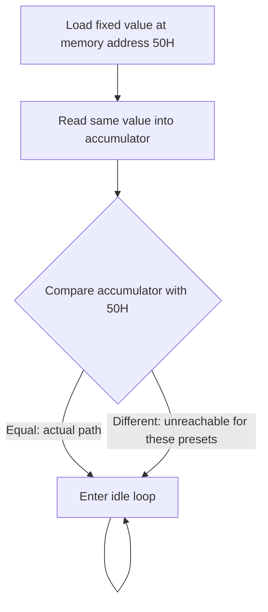
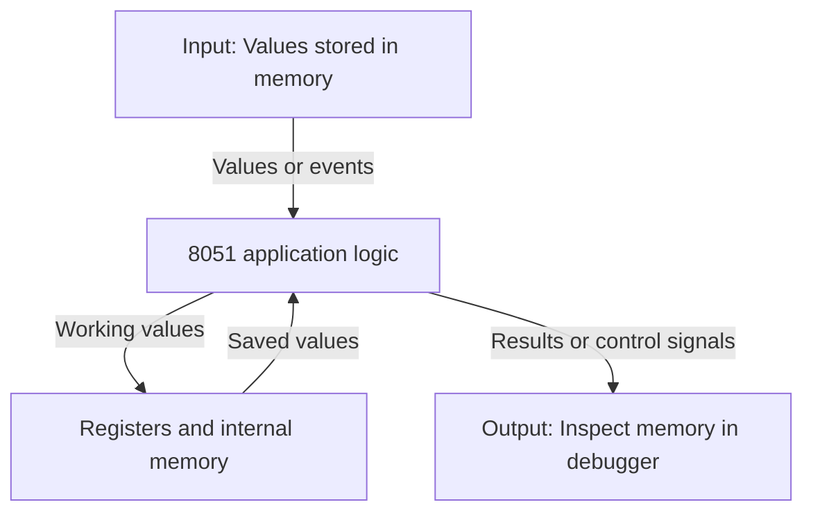

# Code Comparison Demonstration

[Group overview](../../README.md) · [Compare implementations](../README.md)

Demonstrate a comparison whose two operands come from the same memory value.

**Implementation:** Comparison Of Identical Values

**Input:** values stored in memory.  
**Output:** inspect memory in debugger.

## Inputs and results

| Parameter | Description |
| --- | --- |
| Input | A fixed value in the source |
| Output | An idle loop, with no user-facing result |

## Worked example

Both compared values are 12H, so they are equal. The program then remains in its final loop.

### Calculation details

Run from the start. The code overwrites 50H with 12H, loads A from 50H and compares A against 50H. Both are 12H. The comparison falls through to EXIT and SJMP $ keeps the CPU there.

## Program operation

### Functional flowchart

[Detailed control flow](source-flow.md)

### Simplified block diagram

Results are available in memory without a display.

## Technical limitations

No additional defect was recorded in the earlier source review. This is not evidence of a successful build or hardware test.

## Build and test

1. Open the [assembly source](source.asm) in an 8051 assembler or simulator.
2. Review the technical limitations and configure the peripherals required by this implementation.
3. Check the expected result using the example inputs.
