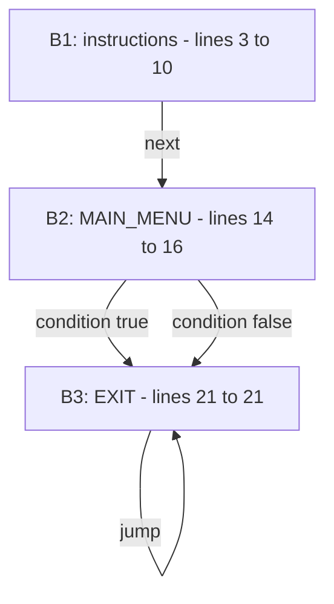

# Program Control Flow

[Back to project](README.md)

Control-flow blocks are indexed by source line. Calls resume at the instruction following the call if the subroutine returns normally.

## Entry locations

- `org 0h` begins at B1.

## Navigation

[Section 1](#section-1)

## Section 1



### B1

```asm
MOV 30H,#12H
MOV 40H,#100
MOV 50H,#0
MOV 51H,#1
MOV 52H,#100
```

### B2

```asm
MOV 50H,#12H
MOV A,50H
CJNE A,50H,EXIT
```

### B3

```asm
SJMP $
```
