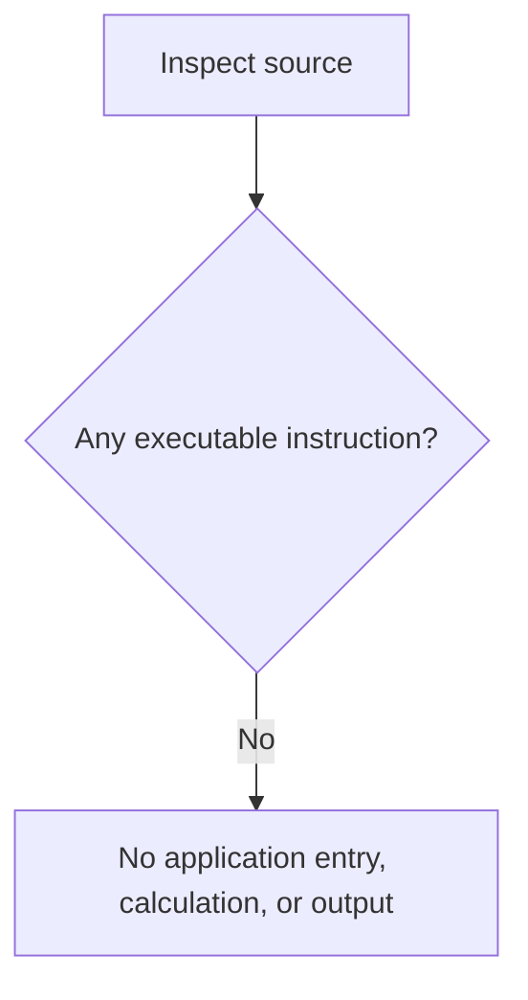

# Empty Assembly Templates

[Group overview](../../README.md) · [Compare implementations](../README.md)

Preserve an empty or directive-only assembly file as an incomplete exercise.

**Implementation:** Empty Listing

**Input:** none.  
**Output:** none.

## Inputs and results

| Parameter | Description |
| --- | --- |
| Input | No executable input path |
| Output | No program-defined output |

## Worked example

There are no application instructions to run, so there is no numerical input/output demonstration.

### Calculation details

Open the source and look for an executable instruction. There is no application path to step through. A reset therefore has no input-to-output example defined by this file.

## Program operation

### Functional flowchart

[Detailed control flow](source-flow.md)

### Simplified block diagram

This file has no executable input, processing, or output blocks.

## Technical limitations

No additional defect was recorded in the earlier source review. This is not evidence of a successful build or hardware test.

## Build and test

1. Open the [assembly source](source.asm) in an 8051 assembler or simulator.
2. Review the technical limitations and configure the peripherals required by this implementation.
3. Check the expected result using the example inputs.
