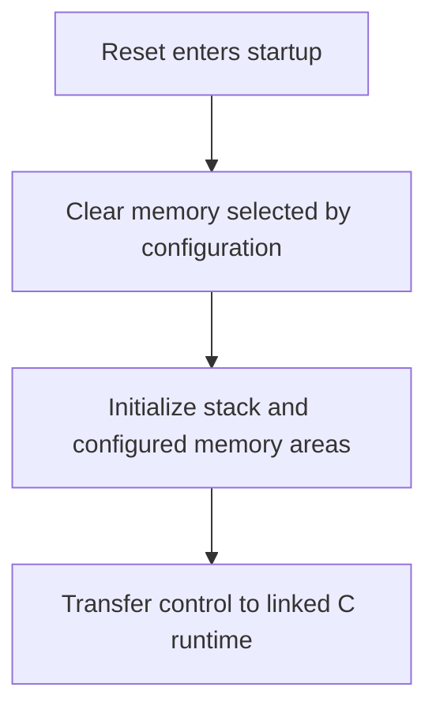
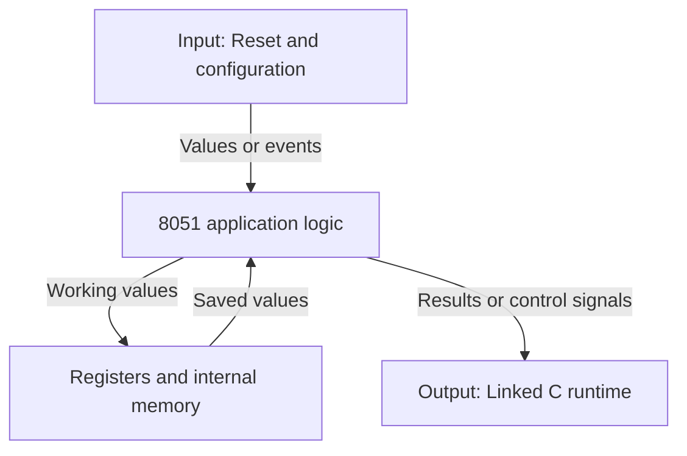

# Keil C51 Startup Module

[Group overview](../../README.md) · [Compare implementations](../README.md)

Initialize the configured memory and stack before a linked C program starts.

**Implementation:** Configured C Runtime Initialization

**Input:** reset and configuration.  
**Output:** linked c runtime.

## Inputs and results

| Parameter | Description |
| --- | --- |
| Input | Reset and assembly-time configuration |
| Output | Control transferred to the linked C runtime |

## Worked example

With the supplied internal-memory length of 128 bytes, the startup clear loop changes a nonzero byte at address 30H to zero.

### Calculation details

With the supplied IDATALEN of 80H, the startup configuration covers 128 internal data bytes. Before startup put a nonzero value in internal RAM at 30H. After the internal-data clear loop, inspect 30H for 00H. A complete run requires the linked application runtime.

## Program operation

1. Reset enters startup.
2. Clear memory selected by configuration.
3. Initialize stack and configured memory areas.
4. Transfer control to linked C runtime.

### Functional flowchart

[Detailed control flow](source-flow.md)

### Simplified block diagram

**Port registers:** `P2`.

## Technical limitations

No additional defect was recorded in the earlier source review. This is not evidence of a successful build or hardware test.

## Build and test

1. Open the [assembly source](source.a51) in an 8051 assembler or simulator.
2. Review the technical limitations and configure the peripherals required by this implementation.
3. Check the expected result using the example inputs.
