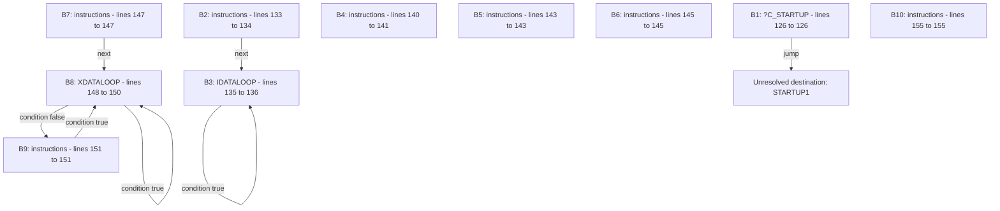
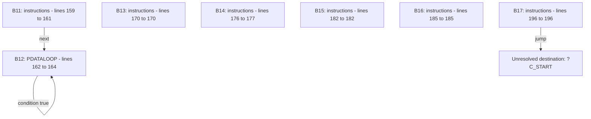

# Program Control Flow

[Back to project](README.md)

Control-flow blocks are indexed by source line. Calls resume at the instruction following the call if the subroutine returns normally.

## Entry locations

Start from the first executable block or the entry selected by the calling application.

## Navigation

[Section 1](#section-1) · [Section 2](#section-2)

## Destinations requiring review

`?C_START`, `STARTUP1`. A repeated label is also unresolved because it has more than one candidate target.

## Lines outside the instruction parser

These may be assembler directives, macros, or malformed source; inspect them before building.

```asm
113: NAME    ?C_STARTUP
122: EXTRN CODE (?C_START)
123: PUBLIC  ?C_STARTUP
192: EXTRN CODE (?B_SWITCH0)
193: CALL    ?B_SWITCH0
```

## Section 1



### B1

```asm
LJMP    STARTUP1
```

### B2

```asm
MOV     R0,#IDATALEN - 1
CLR     A
```

### B3

```asm
MOV     @R0,A
DJNZ    R0,IDATALOOP
```

### B4

```asm
MOV     DPTR,#XDATASTART
MOV     R7,#LOW (XDATALEN)
```

### B5

```asm
MOV     R6,#(HIGH (XDATALEN)) +1
```

### B6

```asm
MOV     R6,#HIGH (XDATALEN)
```

### B7

```asm
CLR     A
```

### B8

```asm
MOVX    @DPTR,A
INC     DPTR
DJNZ    R7,XDATALOOP
```

### B9

```asm
DJNZ    R6,XDATALOOP
```

### B10

```asm
MOV     PPAGE_SFR,#PPAGE
```

## Section 2



### B11

```asm
MOV     R0,#LOW (PDATASTART)
MOV     R7,#LOW (PDATALEN)
CLR     A
```

### B12

```asm
MOVX    @R0,A
INC     R0
DJNZ    R7,PDATALOOP
```

### B13

```asm
MOV     ?C_IBP,#LOW IBPSTACKTOP
```

### B14

```asm
MOV     ?C_XBP,#HIGH XBPSTACKTOP
MOV     ?C_XBP+1,#LOW XBPSTACKTOP
```

### B15

```asm
MOV     ?C_PBP,#LOW PBPSTACKTOP
```

### B16

```asm
MOV     SP,#?STACK-1
```

### B17

```asm
LJMP    ?C_START
```
