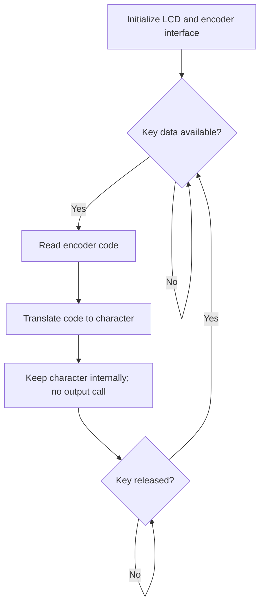
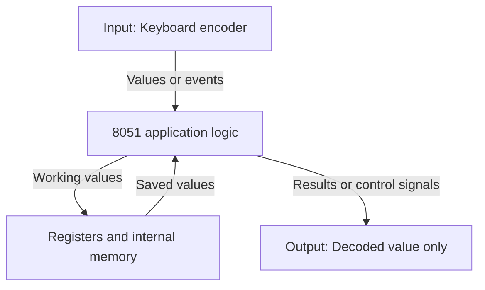

# Key Encoder Polling Sketch

[Group overview](../../README.md) · [Compare implementations](../README.md)

Read a key from an encoder, wait for release, and repeat. The main loop does not send the decoded key to a display.

**Implementation:** Encoder Poll And Release

**Input:** keyboard encoder.  
**Output:** decoded value only.

## Inputs and results

| Parameter | Description |
| --- | --- |
| Input | Encoder key and data-available signal |
| Output | A decoded character inside the processor; no main-loop character output |

## Worked example

Encoder code 0 becomes character 1 internally, but the main loop only waits for release afterward.

### Calculation details

Assert DAV with encoder nibble 0 and release it after KEY returns. The conversion routine maps 0 to ASCII 31H. A holds the decoded key, but the main loop immediately waits for release. It makes no character-output call on that path.

## Program operation

### Functional flowchart

[Detailed control flow](source-flow.md)

### Simplified block diagram

**Port registers:** `P1`, `P2`, `P3.2`, `P3.3`, `P3.6`, `P3.7`.

## Technical limitations

- The polling loop calls KEY and waits for release. SEND and WRDATA are defined separately.

## Build and test

1. Open the [assembly source](source.asm) in an 8051 assembler or simulator.
2. Review the technical limitations and configure the peripherals required by this implementation.
3. Check the expected result using the example inputs.
