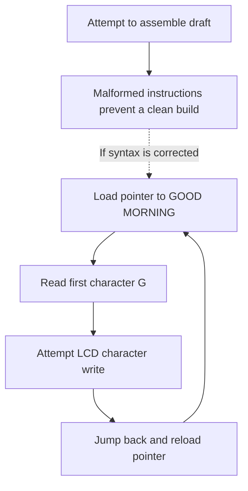
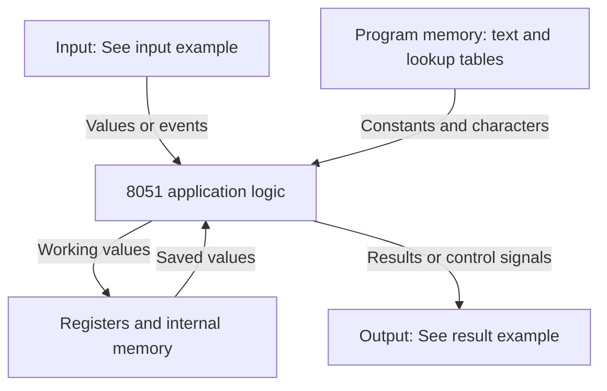

# LCD Greeting — Incomplete

[Group overview](../../README.md) · [Compare implementations](../README.md)

Attempt to display a greeting stored in program memory. The current draft does not correctly print the complete message.

**Implementation:** Greeting With Pointer Reset Error

**Input:** see input example.  
**Output:** see result example.

## Inputs and results

| Parameter | Description |
| --- | --- |
| Input | The stored text GOOD MORNING |
| Output | No verified complete greeting from the unmodified draft |

## Worked example

The first character is G. Reloading the message pointer on every pass selects G again instead of advancing through the greeting.

### Calculation details

The ROM table starts with G = 47H. After a valid pointer load and MOVC, A would hold 47H for DATA_DISPLAY. Even after correcting malformed opcodes, SJMP START reloads DPTR with the same address, so repeated iterations select G again. The whole greeting is not produced as written.

## Program operation

### Functional flowchart

[Detailed control flow](source-flow.md)

### Simplified block diagram

**Port registers:** `P1`, `P1.2`, `P1.3`, `P1.5`, `P1.7`.

## Technical limitations

- The initial ORG lacks an address. SET BP1.2 and SETBP1.5 are malformed. The loop also reloads DPTR at START.

## Build and test

1. Open the [assembly source](source.asm) in an 8051 assembler or simulator.
2. Review the technical limitations and configure the peripherals required by this implementation.
3. Check the expected result using the example inputs.
