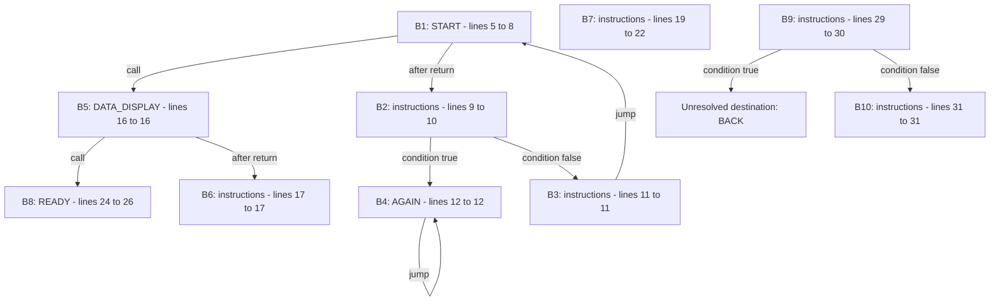

# Program Control Flow

[Back to project](README.md)

Control-flow blocks are indexed by source line. Calls resume at the instruction following the call if the subroutine returns normally.

## Entry locations

- `ORG` begins at B1.

## Navigation

[Section 1](#section-1)

## Destinations requiring review

`BACK`. A repeated label is also unresolved because it has more than one candidate target.

## Lines outside the instruction parser

These may be assembler directives, macros, or malformed source; inspect them before building.

```asm
18: SET BP1.2
28: SETBP1.5
```

## Section 1



### B1

```asm
MOV DPTR,#STRING
CLR A
MOVC A,@A+DPTR
ACALL DATA_DISPLAY
```

### B2

```asm
INC DPTR
JZ AGAIN
```

### B3

```asm
SJMP START
```

### B4

```asm
SJMP AGAIN
```

### B5

```asm
ACALL READY
```

### B6

```asm
MOV P1,A
```

### B7

Return to the instruction following the active call.

```asm
CLR P1.3
SETB P1.5
CLR P1.5
RET
```

### B8

```asm
SETB P1.7
CLR P1.2
SETB P1.5
```

### B9

```asm
CLR P1.5
JB P1.7,BACK
```

### B10

Return to the instruction following the active call.

```asm
RET
```
