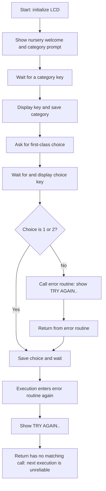
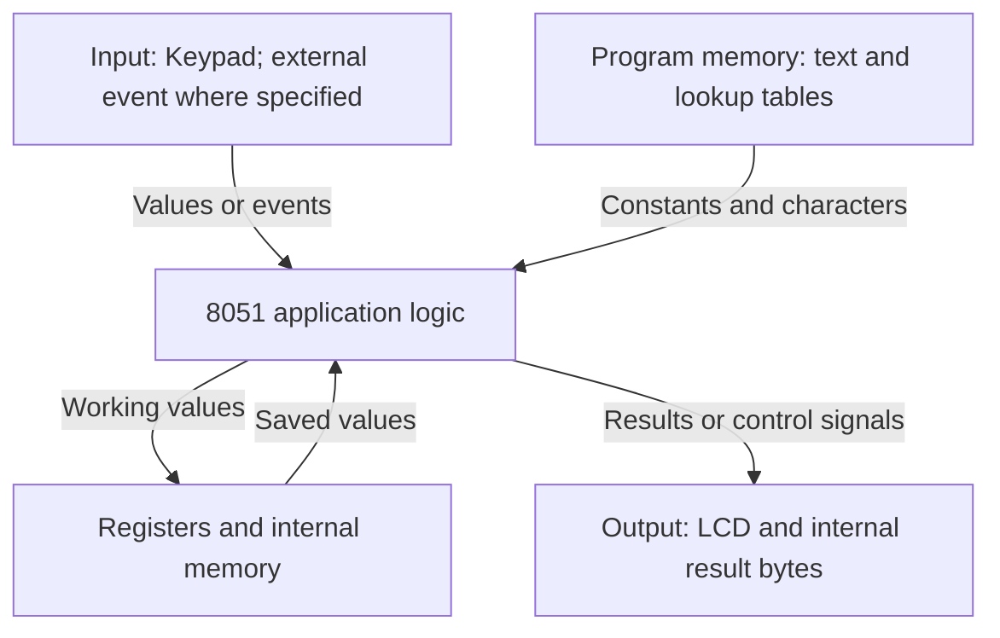

# Nursery Booking Form — Incomplete

[Group overview](../../README.md) · [Compare implementations](../README.md)

Collect two choices for a nursery booking: a category and whether first-class service is wanted. This is an unfinished form; it does not calculate a fee.

**Implementation:** Keypad Form With Error After Selection

**Input:** keypad.  
**Output:** LCD and internal result bytes.

## Inputs and results

| Parameter | Description |
| --- | --- |
| Input | A category key, then a first-class choice of 1 or 2 |
| Output | The two choices are stored, but the program then displays TRY AGAIN.. instead of a total |

## Worked example

Enter category 2 and first-class choice 1. The program saves both numbers, then displays TRY AGAIN.. even though 1 is accepted. No booking price is produced.

### Calculation details

Enter the keypad characters 2 and 1. Their low nibbles are 2 and 1. The program stores 02H at 30H and 01H at 31H. Execution then falls into ERR after the delays, even though 1 was accepted. A final fare cannot be inferred from this partial revision.

## Program operation

### Functional flowchart

This diagram includes both accepted and rejected choices and the erroneous final return. There is no successful price-output path in this listing.

### Simplified block diagram

**Port registers:** `P0`, `P0.4`, `P1`, `P1.2`, `P1.3`, `P1.4`, `P1.5`, `P1.6`, `P1.7`.

## Technical limitations

The accepted-choice route continues directly into the error routine. That routine ends with a return instruction even though this route did not call it. Execution after that return is unreliable. The invalid-choice route also returns into the save-choice code instead of asking for another key. No fee-calculation instructions follow the form.

## Build and test

1. Open the [assembly source](source.asm) in an 8051 assembler or simulator.
2. Review the technical limitations and configure the peripherals required by this implementation.
3. Check the expected result using the example inputs.
