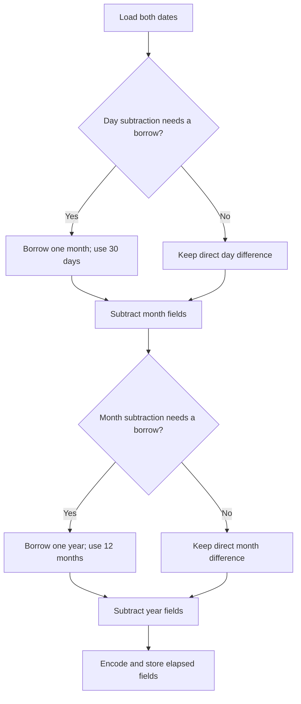
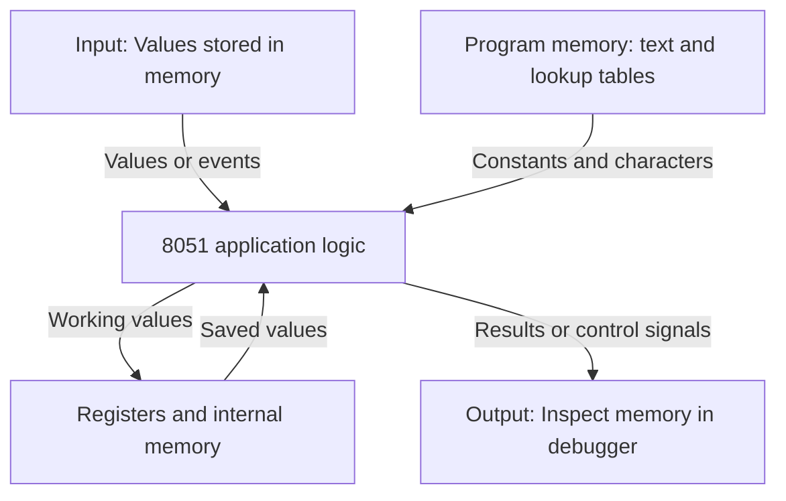

# Date Interval

[Group overview](../../README.md) · [Compare implementations](../README.md)

Subtract two stored dates using separate day, month, and year fields.

**Implementation:** Date Tables March Interval

**Input:** values stored in memory.  
**Output:** inspect memory in debugger.

## Inputs and results

| Parameter | Description |
| --- | --- |
| Input | Two dates stored in the source |
| Output | Elapsed day, month, and year fields in memory |

## Worked example

From 7 August 2021 to 10 December 2021, the documented field subtraction gives 3 days and 4 months.

### Calculation details

Test the DURATION routine with current date 10/12/2021 and comparison date 07/08/2021, carry initially clear. The day difference is 3, the month difference is 4 and the year difference is 0. The packed result starts 03H, 04H, 00H, 00H at 50H.

## Program operation

### Functional flowchart

[Detailed control flow](source-flow.md)

### Simplified block diagram

Results are available in memory without a display.

## Technical limitations

No additional defect was recorded in the earlier source review. This is not evidence of a successful build or hardware test.

## Build and test

1. Open the [assembly source](source.asm) in an 8051 assembler or simulator.
2. Review the technical limitations and configure the peripherals required by this implementation.
3. Check the expected result using the example inputs.
