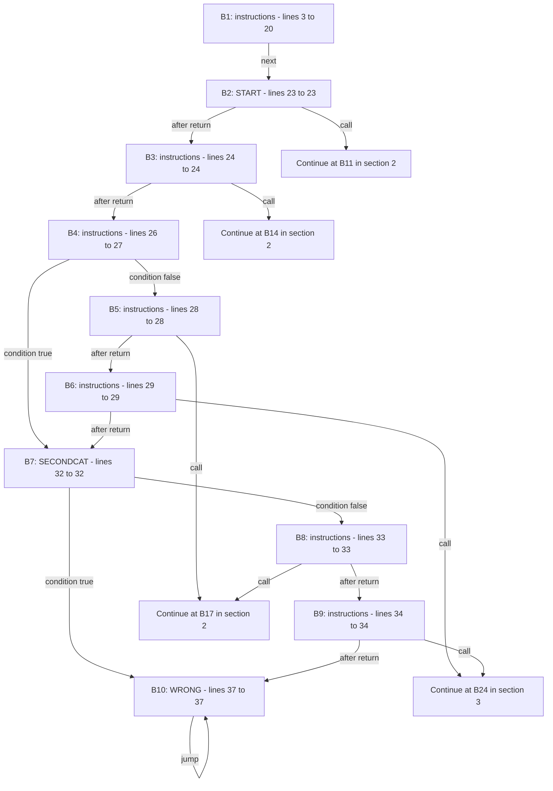
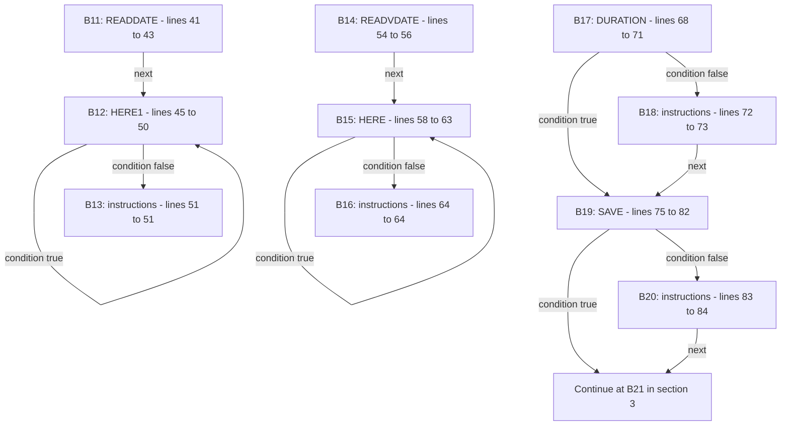
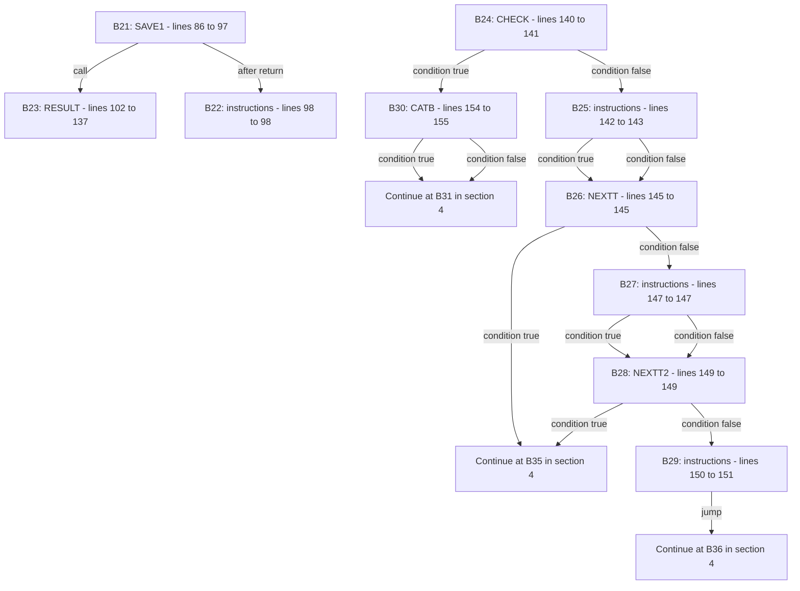
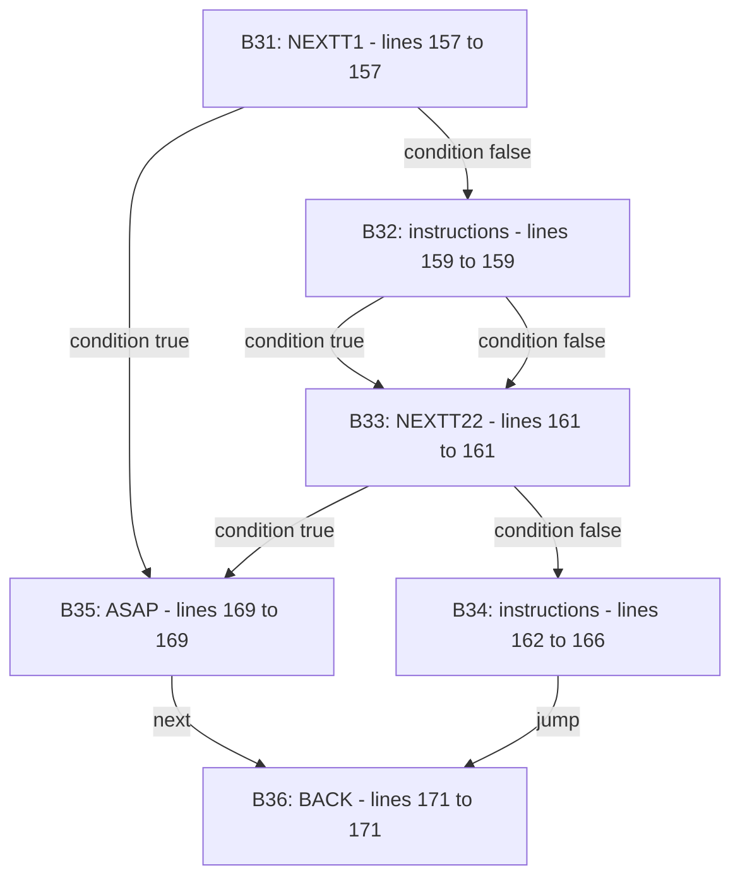

# Program Control Flow

[Back to project](README.md)

Control-flow blocks are indexed by source line. Calls resume at the instruction following the call if the subroutine returns normally.

## Entry locations

- `ORG 0H` begins at B1.

## Navigation

[Section 1](#section-1) · [Section 2](#section-2) · [Section 3](#section-3) · [Section 4](#section-4)

## Section 1



### B1

```asm
MOV R7,#'B'
MOV R6,#0
MOV 50H,#0
MOV 51H,#0
MOV 52H,#0
MOV 53H,#0
MOV 30H,#0
MOV 31H,#0
MOV 32H,#0
MOV 33H,#0
MOV 40H,#0
MOV 41H,#0
MOV 42H,#0
MOV 43H,#0
```

### B2

```asm
ACALL ReadDATE
```

### B3

```asm
ACALL ReadVdate
```

### B4

```asm
MOV A,R7
CJNE A,#'A',SECONDCAT
```

### B5

```asm
ACALL DURATION
```

### B6

```asm
ACALL CHECK
```

### B7

```asm
CJNE A,#'B',WRONG
```

### B8

```asm
ACALL DURATION
```

### B9

```asm
ACALL CHECK
```

### B10

```asm
SJMP $
```

## Section 2



### B11

```asm
MOV DPTR,#CdatE
MOV R0,#30H
MOV R2,#4
```

### B12

```asm
CLR A
MOVC A,@A+DPTR
MOV @R0,A
INC R0
INC DPTR
DJNZ R2,HERE1
```

### B13

Return to the instruction following the active call.

```asm
RET
```

### B14

```asm
MOV DPTR,#VdatE
MOV R0,#40H
MOV R2,#4
```

### B15

```asm
CLR A
MOVC A,@A+DPTR
MOV @R0,A
INC R0
INC DPTR
DJNZ R2,HERE
```

### B16

Return to the instruction following the active call.

```asm
RET
```

### B17

```asm
MOV R6,#0
MOV A,30H
SUBB A,40H
JNC SAVE
```

### B18

```asm
ADD A,#30
MOV R6,#1
```

### B19

```asm
MOV 60H,A
CLR C
MOV R5,#0
MOV A,31H
SUBB A,R6
SUBB A,41H
JNC SAVE1
```

### B20

```asm
ADD A,#12
MOV R5,#1
```

## Section 3



### B21

```asm
MOV 61H,A
CLR C
MOV A,32H
SUBB A,R5
SUBB A,42H
MOV 62H,A
MOV A,33H
SUBB A,43H
MOV 63H,A
ACALL RESULT
```

### B22

Return to the instruction following the active call.

```asm
RET
```

### B23

Return to the instruction following the active call.

```asm
MOV A,60H
MOV B,#10
DIV AB
MOV R3,B
MOV B,#16
MUL AB
ADD A,R3
MOV 50H,A
MOV A,61H
MOV B,#10
DIV AB
MOV R3,B
MOV B,#16
MUL AB
ADD A,R3
MOV 51H,A
MOV A,62H
MOV B,#10
DIV AB
MOV R3,B
MOV B,#16
MUL AB
ADD A,R3
MOV 52H,A
MOV A,63H
MOV B,#10
DIV AB
MOV R3,B
MOV B,#16
MUL AB
ADD A,R3
MOV 53H,A
RET
```

### B24

```asm
MOV A,R7
CJNE A,#'A',CATB
```

### B25

```asm
MOV A,62H
CJNE A,#1,NEXTT
```

### B26

```asm
JNC ASAP
```

### B27

```asm
CJNE A,#1,NEXTT2
```

### B28

```asm
JNC ASAP
```

### B29

```asm
MOV R6,#0H
SJMP BACK
```

### B30

```asm
MOV A,62H
CJNE A,#1,NEXTT1
```

## Section 4



### B31

```asm
JNC ASAP
```

### B32

```asm
CJNE A,#6,NEXTT22
```

### B33

```asm
JNC ASAP
```

### B34

```asm
CLR C
MOV A,61H
SUBB A,#6
MOV R6,A
SJMP BACK
```

### B35

```asm
MOV R6,#0FFH
```

### B36

Return to the instruction following the active call.

```asm
RET
```
