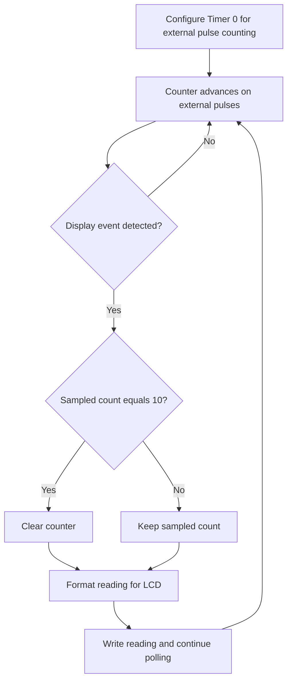
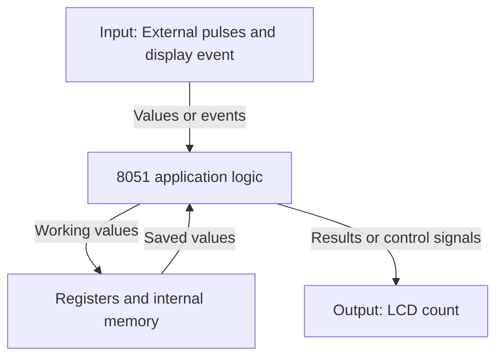

# External Pulse Counter

[Group overview](../../README.md) · [Compare implementations](../README.md)

Count external pulses and display the count when the display event is detected.

**Implementation:** Timer Zero Pulse Display

**Input:** external pulses and display event.  
**Output:** LCD count.

## Inputs and results

| Parameter | Description |
| --- | --- |
| Input | Pulses on the Timer 0 external input and the display-control signal |
| Output | A count on the LCD |

## Worked example

Starting at zero, three countable pulses produce the displayed text 00003.

### Calculation details

Start with TL0 = 0. Supply three countable pulses on T0, then assert DAV to show the count. The code reads 3, adds ASCII 30H and writes four zeros followed by 3. The LCD receives 00003. When TL0 equals 10 at the check, the code clears it.

## Program operation

### Functional flowchart

[Detailed control flow](source-flow.md)

### Simplified block diagram

**Port registers:** `P1`, `P2`, `P3.0`, `P3.1`, `P3.2`, `P3.3`, `P3.4`.

## Technical limitations

No additional defect was recorded in the earlier source review. This is not evidence of a successful build or hardware test.

## Build and test

1. Open the [assembly source](source.asm) in an 8051 assembler or simulator.
2. Review the technical limitations and configure the peripherals required by this implementation.
3. Check the expected result using the example inputs.
