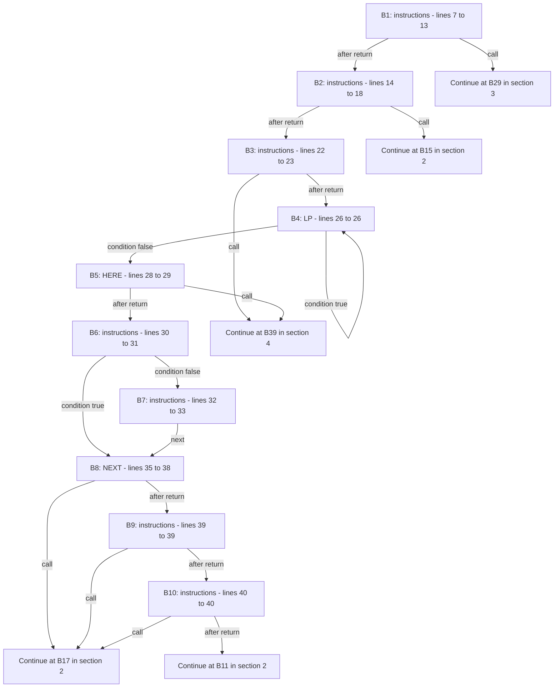
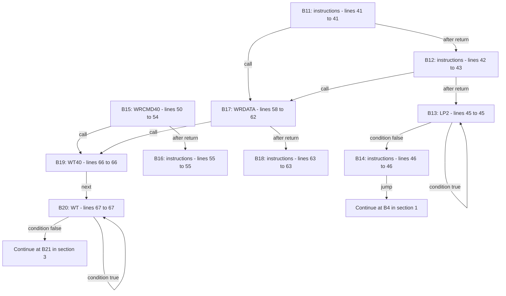
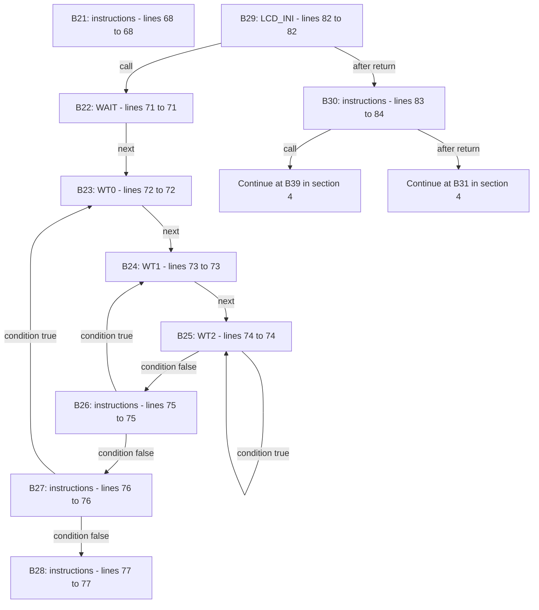
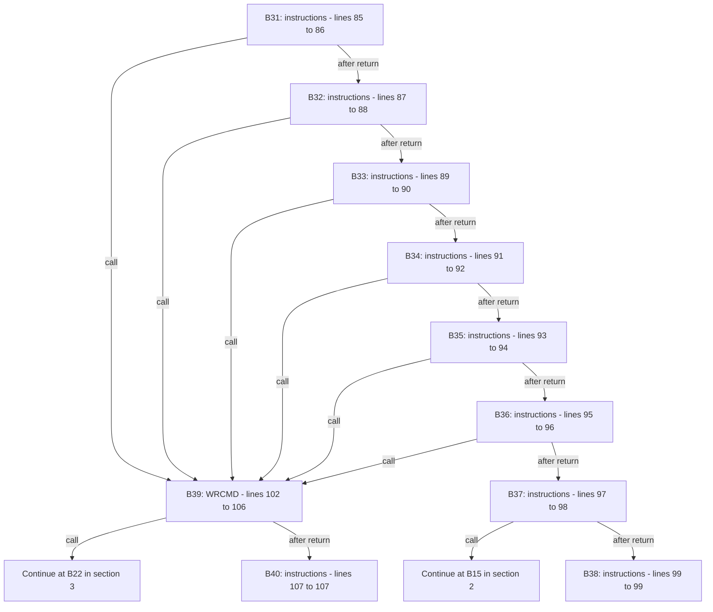

# Program Control Flow

[Back to project](README.md)

Control-flow blocks are indexed by source line. Calls resume at the instruction following the call if the subroutine returns normally.

## Entry locations

- `ORG 000H` begins at B1.

## Navigation

[Section 1](#section-1) · [Section 2](#section-2) · [Section 3](#section-3) · [Section 4](#section-4)

## Section 1



### B1

```asm
MOV TMOD, #06H
MOV TH0, #0
MOV TL0, #0
MOV P1,#0FFH
SETB P3.4
ACALL LCD_INI
```

### B2

```asm
SETB TR0
SETB DAV
MOV A,#80H
ACALL WRCMD40
```

### B3

```asm
MOV A,#1
ACALL WRCMD
```

### B4

```asm
JNB DAV,LP
```

### B5

```asm
MOV A,#80h
ACALL WRCMD
```

### B6

```asm
MOV A, TL0
CJNE A,#10,NEXT
```

### B7

```asm
MOV A,#0
MOV TL0,#0
```

### B8

```asm
ADD A,#30H
MOV R4,A
MOV A,#30h
ACALL WRDATA
```

### B9

```asm
ACALL WRDATA
```

### B10

```asm
ACALL WRDATA
```

## Section 2



### B11

```asm
ACALL WRDATA
```

### B12

```asm
MOV A,R4
ACALL WRDATA
```

### B13

```asm
JB DAV,LP2
```

### B14

```asm
SJMP LP
```

### B15

```asm
MOV P2,A
CLR RS
SETB E
CLR E
ACALL WT40
```

### B16

Return to the instruction following the active call.

```asm
RET
```

### B17

```asm
MOV P2,A
SETB RS
SETB E
CLR E
ACALL WT40
```

### B18

Return to the instruction following the active call.

```asm
RET
```

### B19

```asm
MOV R0,#19
```

### B20

```asm
DJNZ R0,WT
```

## Section 3



### B21

Return to the instruction following the active call.

```asm
RET
```

### B22

```asm
MOV R5,#1
```

### B23

```asm
MOV R6,#28
```

### B24

```asm
MOV R7,#255
```

### B25

```asm
DJNZ R7,WT2
```

### B26

```asm
DJNZ R6,WT1
```

### B27

```asm
DJNZ R5,WT0
```

### B28

Return to the instruction following the active call.

```asm
RET
```

### B29

```asm
ACALL WAIT
```

### B30

```asm
MOV A,#38H
ACALL WRCMD
```

## Section 4



### B31

```asm
MOV A,#038H
ACALL WRCMD
```

### B32

```asm
MOV A,#038H
ACALL WRCMD
```

### B33

```asm
MOV A,#038H
ACALL WRCMD
```

### B34

```asm
MOV A,#8
ACALL WRCMD
```

### B35

```asm
MOV A,#1
ACALL WRCMD
```

### B36

```asm
MOV A,#6
ACALL WRCMD
```

### B37

```asm
MOV A,#0FH
ACALL WRCMD40
```

### B38

Return to the instruction following the active call.

```asm
RET
```

### B39

```asm
MOV P2,A
CLR RS
SETB E
CLR E
ACALL WAIT
```

### B40

Return to the instruction following the active call.

```asm
RET
```
