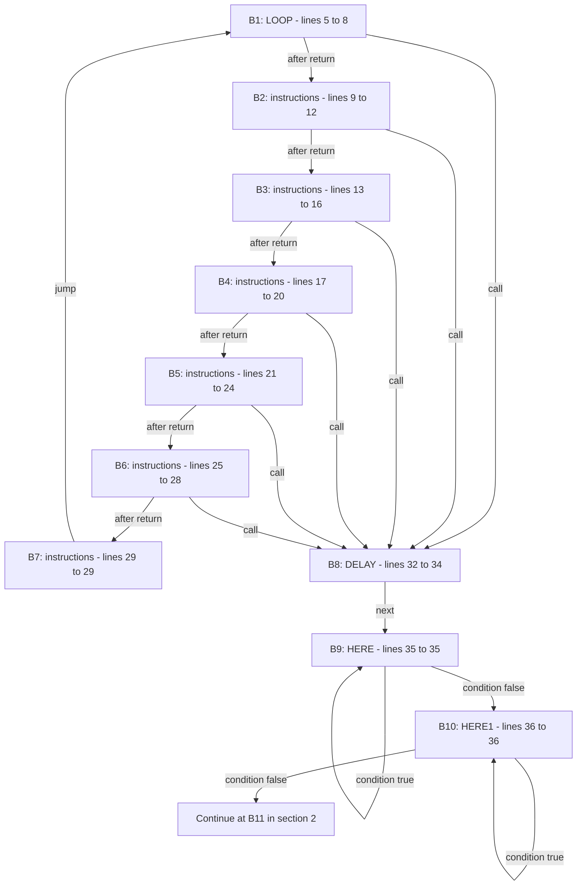
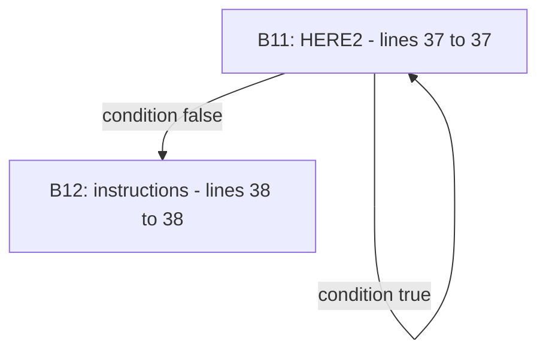

# Program Control Flow

[Back to project](README.md)

Control-flow blocks are indexed by source line. Calls resume at the instruction following the call if the subroutine returns normally.

## Entry locations

- `ORG 00H` begins at B1.

## Navigation

[Section 1](#section-1) · [Section 2](#section-2)

## Section 1



### B1

```asm
MOV P1,#00000001B
MOV P2,#00000100B
MOV P3,#00000100B
ACALL DELAY
```

### B2

```asm
MOV P1,#00000010B
MOV P2,#00000010B
MOV P3,#00000100B
ACALL DELAY
```

### B3

```asm
MOV P1,#00000100B
MOV P2,#00000001B
MOV P3,#00000100B
ACALL DELAY
```

### B4

```asm
MOV P1,#00000100B
MOV P2,#00000010B
MOV P3,#00000010B
ACALL DELAY
```

### B5

```asm
MOV P1,#00000100B
MOV P2,#00000100B
MOV P3,#00000001B
ACALL DELAY
```

### B6

```asm
MOV P1,#00000010B
MOV P2,#00000100B
MOV P3,#00000010B
ACALL DELAY
```

### B7

```asm
AJMP LOOP
```

### B8

```asm
MOV R7,#0FFH
MOV R6,#0FFH
MOV R5,#0FFH
```

### B9

```asm
DJNZ R6,HERE
```

### B10

```asm
DJNZ R7,HERE1
```

## Section 2



### B11

```asm
DJNZ R5,HERE2
```

### B12

Return to the instruction following the active call.

```asm
RET
```
