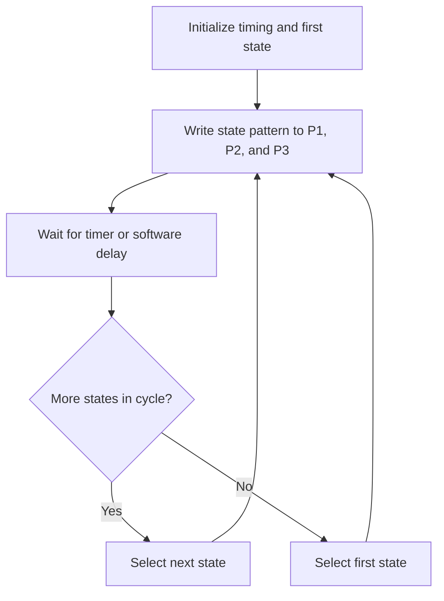
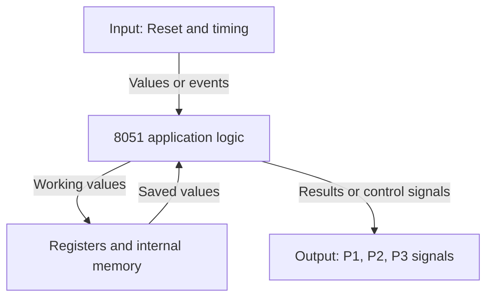

# Traffic Light Sequencer

[Group overview](../../README.md) · [Compare implementations](../README.md)

Repeatedly send a sequence of signal patterns to three output ports.

**Implementation:** Timer Driven Port States

**Input:** reset and timing.  
**Output:** p1, p2, p3 signals.

## Inputs and results

| Parameter | Description |
| --- | --- |
| Input | Reset and completion of each timing interval |
| Output | Changing bit patterns on P1, P2, and P3 |

## Worked example

The software-delay version cycles through six documented patterns and then returns to the first. The physical light colours depend on the connected circuit.

### Calculation details

After reset R6 starts at 3. In the first traffic state R1, R2 and R3 are loaded with 01H, 04H and 04H. The writes at BACK put those levels on P1, P2 and P3. Watch the three port registers as the timer-driven sequence advances.

## Program operation

### Functional flowchart

[Detailed control flow](source-flow.md)

### Simplified block diagram

**Port registers:** `P1`, `P2`, `P3`.

## Technical limitations

No additional defect was recorded in the earlier source review. This is not evidence of a successful build or hardware test.

## Build and test

1. Open the [assembly source](source.asm) in an 8051 assembler or simulator.
2. Review the technical limitations and configure the peripherals required by this implementation.
3. Check the expected result using the example inputs.
