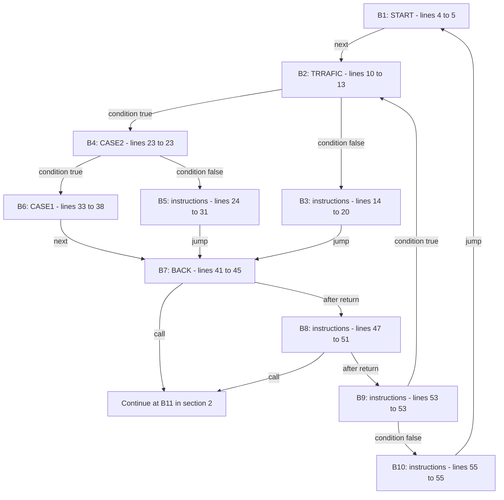
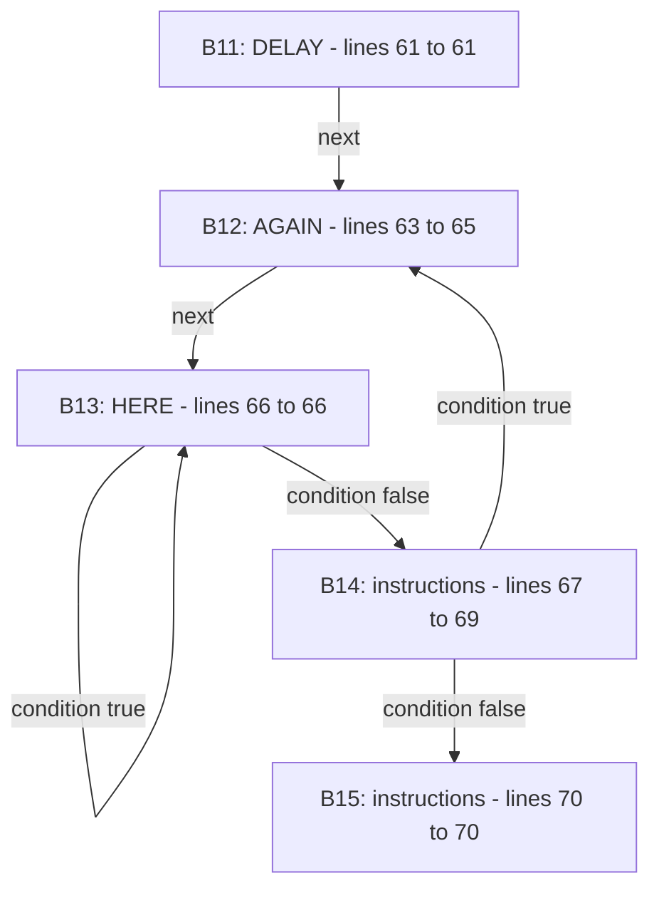

# Program Control Flow

[Back to project](README.md)

Control-flow blocks are indexed by source line. Calls resume at the instruction following the call if the subroutine returns normally.

## Entry locations

- `ORG 00H` begins at B1.

## Navigation

[Section 1](#section-1) · [Section 2](#section-2)

## Section 1



### B1

```asm
MOV TMOD,#01
MOV R6,#3
```

### B2

```asm
MOV A,R6
CJNE A,#3,CASE2
```

### B3

```asm
MOV R1,#1H
MOV R2,#4H
MOV R3,#4H
MOV R4,#1H
MOV R5,#2H
MOV R0,#4H
SJMP BACK
```

### B4

```asm
CJNE A,#2,CASE1
```

### B5

```asm
MOV R1,#4H
MOV R2,#1H
MOV R3,#4H
MOV R4,#4H
MOV R5,#1H
MOV R0,#2H
SJMP BACK
```

### B6

```asm
MOV R1,#4H
MOV R2,#4H
MOV R3,#1H
MOV R4,#2H
MOV R5,#4H
MOV R0,#1H
```

### B7

```asm
MOV P1,R1
MOV P2,R2
MOV P3,R3
MOV R7,#40
ACALL DELAY
```

### B8

```asm
MOV P1,R4
MOV P2,R5
MOV P3,R0
MOV R7,#20
ACALL DELAY
```

### B9

```asm
DJNZ R6,TRRAFIC
```

### B10

```asm
SJMP START
```

## Section 2



### B11

```asm
MOV R7,#20
```

### B12

```asm
MOV TH0,#3CH
MOV TL0,#0ADH
SETB TR0
```

### B13

```asm
JNB TF0,HERE
```

### B14

```asm
CLR TR0
CLR TF0
DJNZ R7,AGAIN
```

### B15

Return to the instruction following the active call.

```asm
RET
```
