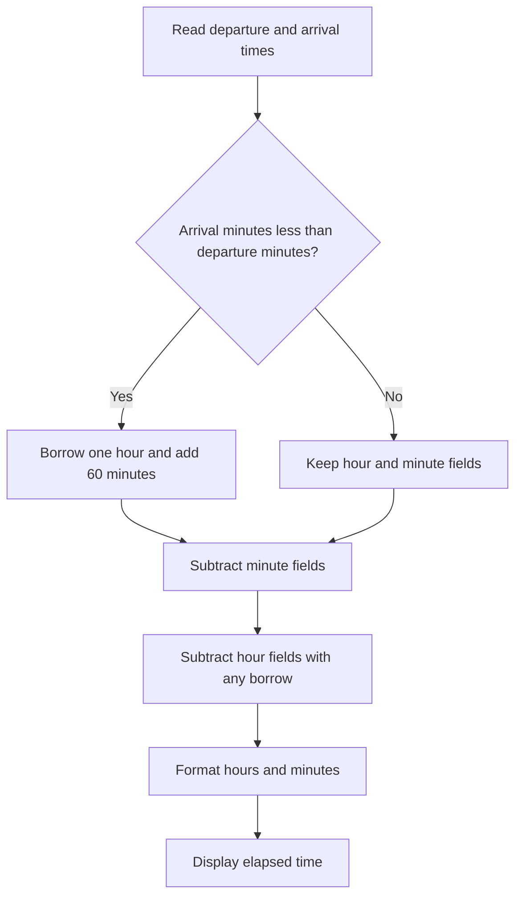
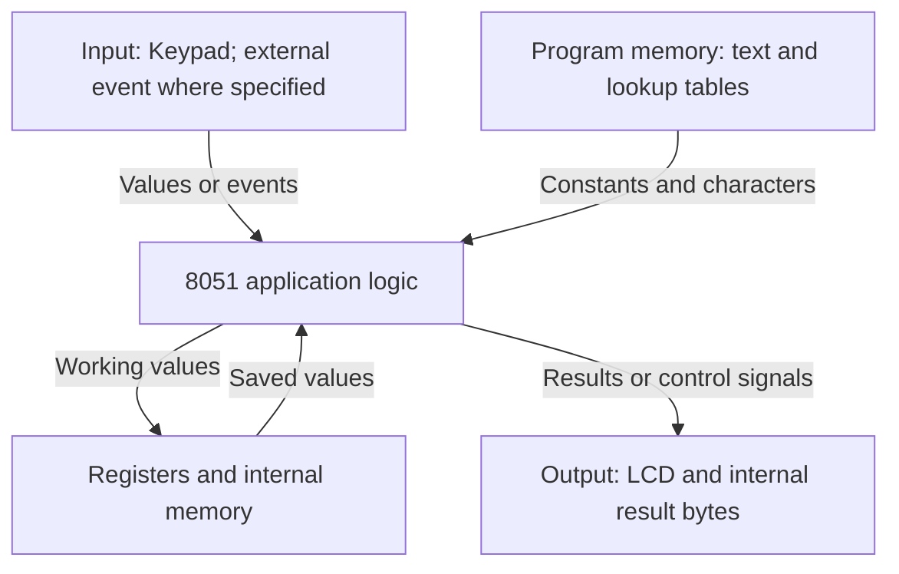

# Travel Duration

[Group overview](../../README.md) · [Compare implementations](../README.md)

Subtract departure time from arrival time and format the elapsed hours and minutes.

**Implementation:** Keypad Hour Minute Difference

**Input:** keypad.  
**Output:** LCD and internal result bytes.

## Inputs and results

| Parameter | Description |
| --- | --- |
| Input | Departure and arrival hours and minutes |
| Output | Elapsed time on the display |

## Worked example

Departure 09:15 and arrival 10:45 give 1 hour 30 minutes. The source separates the displayed fields with a slash.

### Calculation details

Enter arrival 10:45 and departure 09:15. Hours subtract to 1 and minutes to 30. No minute borrow is required. With carry clear at the initial subtraction, 40H holds 01H and 41H holds 1EH. The display code separates the fields with a slash.

## Program operation

### Functional flowchart

[Detailed control flow](source-flow.md)

### Simplified block diagram

**Port registers:** `P0`, `P0.4`, `P0.6`, `P1`, `P1.2`, `P1.3`, `P1.4`, `P1.5`, `P1.6`, `P1.7`.

## Technical limitations

No additional defect was recorded in the earlier source review. This is not evidence of a successful build or hardware test.

## Build and test

1. Open the [assembly source](source.asm) in an 8051 assembler or simulator.
2. Review the technical limitations and configure the peripherals required by this implementation.
3. Check the expected result using the example inputs.
